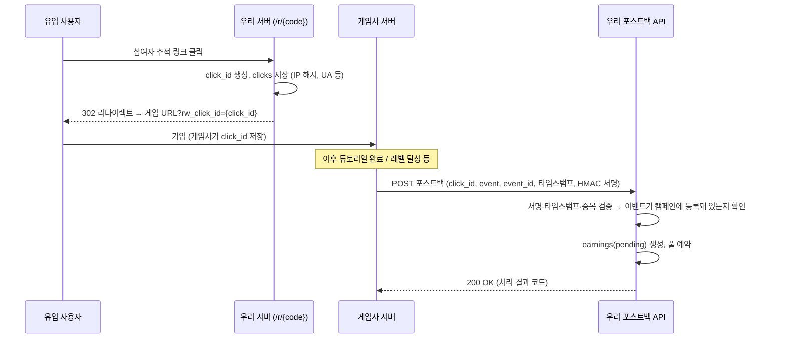
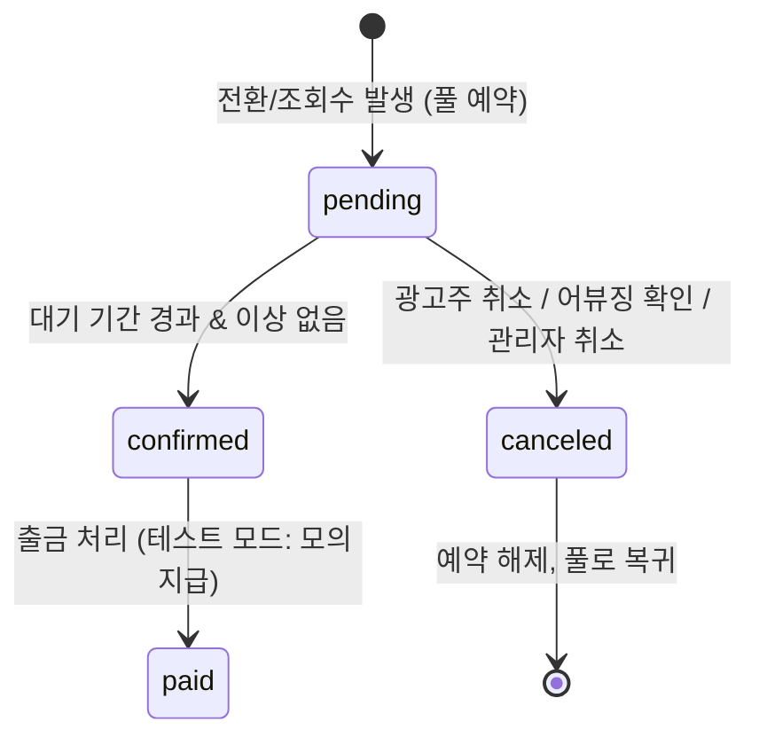
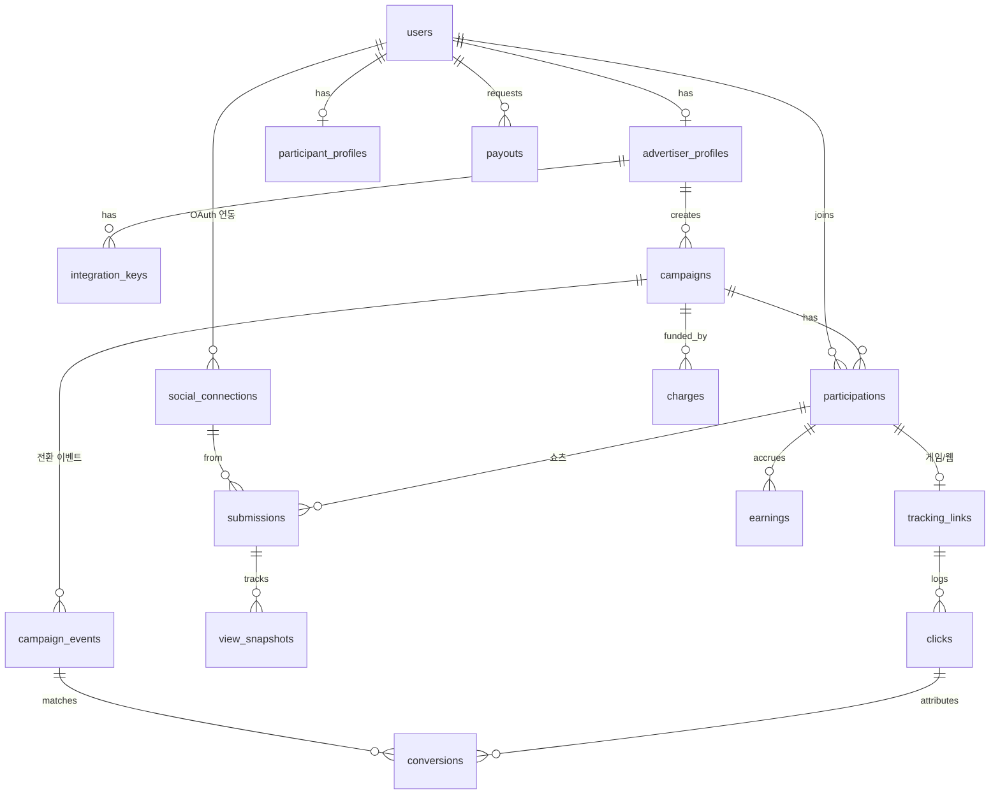

# 홍보 리워드 플랫폼 — 전체 설계 (v0.3)

> 임시 서비스명: **PromoPool (가칭)** · 도메인 미정 → 로컬(`http://localhost:3000`) 기준 개발

> 한국판 Whop "Content Rewards" 스타일. 광고주가 리워드 풀을 걸고, 참여자가 홍보 성과에 따라 풀에서 보상을 받는 구조.
> 작성일: 2026-10-18 · 상태: 설계 확정 중 (코드 작성 전)

### 변경 이력
- **v0.3** (2026-10-18): 수수료 기본 10%(설정값), YouTube 쇼츠 인정 규칙 확정(구현은 MVP 이후), 임시 서비스명·로컬 개발, **MVP 범위를 웹사이트 링크 홍보(클릭당 보상)로 변경**, 남은 항목 "미정" 정리
- **v0.2** (2026-10-18): 개발/테스트 모드 운영 방침(실제 돈 없음) 추가, 결제·정산 모듈 분리, 수수료 방식 확정, 쇼츠 3개 플랫폼 OAuth 연동 설계, 게임 전환 포스트백(S2S)·JS 픽셀 설계, 연동 가이드 페이지, 출시 전 전문가 검토 항목 추가
- v0.1 (2026-10-18): 초안

---

## 0. 한눈에 보기

| 항목 | 결정 |
|---|---|
| 운영 모드 | **사업자 등록(약 6개월 후) 전까지 개발/테스트 버전** — 실제 돈 없이 **테스트 크레딧**으로만 동작 |
| 프레임워크 | Next.js (App Router) + TypeScript |
| UI | Tailwind CSS + shadcn/ui |
| DB | PostgreSQL (로컬: Docker / 운영: AWS RDS) + Prisma |
| 서비스 로그인 | Auth.js(NextAuth v5) — 카카오 · 구글 · 네이버 |
| 쇼츠 성과 수집 | 참여자가 **본인 계정을 OAuth로 연동** → 본인 영상 조회수를 공식 API로 수집 (YouTube → TikTok → Instagram 순) |
| 게임/웹 전환 | **추적 링크 + click_id + 포스트백(S2S, HMAC 서명)** 기본, **JS 픽셀** 보조 |
| 보상 상태 | 모든 보상은 **대기 → 확정 / 취소** (대기 기간은 캠페인별, 기본 7일) |
| 수수료 | **광고주 충전 시 별도 부과, 기본 10%** — 코드에 하드코딩하지 않고 `platform_settings`(DB 설정값)로 관리 |
| 결제·정산 | `PaymentProvider` / `PayoutProvider` 인터페이스로 분리. 지금은 **Mock 구현만**, 나중에 토스페이먼츠·지급대행 구현체 추가 |
| 배포 | **MVP는 로컬 전용** (Docker Postgres). AWS 계정 준비 후 Amplify Hosting + RDS + S3 + EventBridge Scheduler (서울 리전) |
| MVP | **웹사이트 링크 홍보 (클릭당 보상)** — 결제·정산 없이 DB 숫자로만 관리, 로컬 실행 |

---

## 1. 사용자 유형과 주요 화면

### 1-1. 공통

| 화면 | 경로(예시) | 설명 |
|---|---|---|
| 랜딩 | `/` | 서비스 소개, 진행 중인 인기 캠페인. 상단에 **"테스트 버전 — 실제 금전 거래 없음"** 배너 |
| 로그인/회원가입 | `/login` | 소셜 로그인 후 역할 선택(광고주/참여자) |
| 캠페인 탐색 | `/campaigns` | 진행 중 캠페인 목록 (유형·플랫폼·남은 풀·단가 필터) |
| 캠페인 상세 | `/campaigns/[id]` | 가이드라인, 단가/보상 이벤트, 남은 풀, 참여 버튼 |
| 알림 | `/notifications` | 승인/반려/보상 확정·취소/계정 재연동 필요 알림 |
| 내 계정 | `/settings` | 프로필, 역할 전환, 탈퇴 |
| 연동 가이드(공개) | `/docs/integration` | 게임사/웹사이트용 포스트백·픽셀 연동 문서 (로그인 없이 열람) |

> 한 계정이 광고주 + 참여자를 겸할 수 있게 함 (상단에서 모드 전환).

### 1-2. 광고주 (크리에이터 / 게임사 / 웹사이트 운영자)

| 화면 | 경로 | 설명 |
|---|---|---|
| 광고주 대시보드 | `/advertiser` | 캠페인별 소진액·예약액, 조회수/클릭/전환, 남은 풀 |
| 캠페인 생성 | `/advertiser/campaigns/new` | 유형 선택 → (쇼츠) 대상 플랫폼, 1,000회당 단가 / (게임·웹) **전환 이벤트 선택 및 이벤트별 보상액**, 대기 기간, 풀 금액, 기간, 가이드라인, 소재 업로드 |
| 캠페인 관리 | `/advertiser/campaigns/[id]` | 상태(일시정지/종료), 참여자 목록, 제출물/전환 목록 |
| 제출물 검수 | `/advertiser/campaigns/[id]/submissions` | 쇼츠 승인/반려 |
| 전환 관리 | `/advertiser/campaigns/[id]/conversions` | 대기 중 전환 목록, 대기 기간 내 **취소**(사유 입력) |
| 성과 리포트 | `/advertiser/campaigns/[id]/report` | 일별 조회수·클릭·전환·지출 그래프 |
| 연동 설정 | `/advertiser/integrations` | 비밀 키 발급/재발급, 포스트백 URL, 픽셀 코드, 허용 도메인 |
| 연동 테스트 | `/advertiser/integrations/test` | 테스트 click_id 생성, 테스트 포스트백 수신 확인, **수신 로그(서명 실패 사유 포함)** |
| 충전 | `/advertiser/billing` | (테스트 모드) 테스트 크레딧 충전 / (라이브) PG 결제. 풀 + 수수료 표시 |
| 사업자 정보 | `/advertiser/profile` | 회사명, 담당자 (라이브 전환 시 사업자등록번호·세금계산서 정보) |

### 1-3. 참여자 (홍보하는 사람)

| 화면 | 경로 | 설명 |
|---|---|---|
| 참여자 대시보드 | `/me` | 총 수익, 대기/확정 금액, 출금 가능액(테스트), 참여 중 캠페인 |
| 계정 연동 | `/me/connections` | YouTube / TikTok / Instagram **OAuth 연동**, 연동 상태(정상/재연동 필요), 연동 해제 |
| 내 참여 캠페인 | `/me/campaigns` | 캠페인별 성과 및 수익 |
| 쇼츠 제출 | `/me/campaigns/[id]/submit` | 연동된 계정의 **최근 영상 목록에서 선택** (URL 붙여넣기도 지원하되 본인 영상인지 API로 확인) |
| 내 제출물 | `/me/submissions` | 상태(검수중/승인/반려), 조회수 추이, 보상(대기/확정/취소) |
| 내 추적 링크 | `/me/links` | 게임/웹 캠페인 전용 링크, 클릭/전환 수 |
| 출금 | `/me/payouts` | (테스트 모드) 모의 출금 신청·내역 |
| 정산 정보 | `/me/payout-settings` | (라이브 전환 시 활성) 계좌, 본인인증, 원천징수 정보 |

### 1-4. 관리자 (운영자)

| 화면 | 경로 | 설명 |
|---|---|---|
| 관리자 대시보드 | `/admin` | 활성 캠페인, 대기 중 작업 수, 수집 배치 상태 |
| 캠페인 심사 | `/admin/campaigns` | 신규 캠페인 승인 (소재·전환 이벤트 적정성) |
| 제출물 검수 | `/admin/submissions` | 쇼츠 검수 큐, 광고 표기 확인, 어뷰징 플래그 |
| 전환 모니터 | `/admin/conversions` | 포스트백/픽셀 수신 현황, 서명 실패, 이상 패턴 |
| 테스트 크레딧 | `/admin/credits` | 광고주에게 테스트 크레딧 지급/회수 |
| 출금 처리 | `/admin/payouts` | (테스트) 모의 지급 처리 |
| 플랫폼 연동 상태 | `/admin/platforms` | 플랫폼별 API 오류율, 토큰 만료 계정 수, 할당량 사용량 |
| 사용자 관리 | `/admin/users` | 정지/해제, 역할 변경 |
| 원장 조회 | `/admin/ledger` | 모든 (테스트) 돈의 이동 기록 |
| 감사 로그 | `/admin/audit` | 관리자 행동 기록 |

---

## 2. 시스템 구조 — 모듈 분리 원칙

나중에 붙일 것(실결제, 실지급, 새 플랫폼)을 **구현체만 추가하면 되도록** 인터페이스로 경계를 나눈다.

```
src/
  app/                    # 화면 + Route Handler (얇게 유지, 로직은 server/로)
  server/
    ledger/               # 원장 기록 (모든 돈 이동의 단일 진입점)
    billing/              # PaymentProvider: mock (지금) / toss (나중)
    payouts/              # PayoutProvider: mock (지금) / manual·지급대행 (나중)
    rewards/              # 보상 계산 + 상태 머신(pending→confirmed/canceled) + 풀 예약/차감
    platforms/            # SocialPlatformConnector: youtube / tiktok / instagram
      types.ts
      registry.ts
      youtube/  tiktok/  instagram/
    tracking/             # 추적 링크, click_id, 포스트백 검증, 픽셀 수신
    jobs/                 # 조회수 수집, 보상 확정, 토큰 갱신 배치
  lib/                    # 암호화, 공통 유틸
```

### 2-1. 돈 관련: 테스트 모드와 라이브 모드

- 환경변수 `MONEY_MODE=test | live`. **`live`는 사업자 등록·전문가 검토 완료 전까지 코드상 활성화 불가** (부팅 시 차단).
- 테스트 모드에서도 **원장·풀 예약·보상 상태 머신은 실제와 똑같이 동작** → 나중에 Provider만 바꾸면 됨.
- 모든 금액 레코드에 `is_test` 표시. 라이브 전환 시 테스트 데이터와 섞이지 않게 분리.

```ts
interface PaymentProvider {           // 광고주 충전
  createCharge(input: { advertiserId: string; poolAmount: number; feeAmount: number }): Promise<ChargeSession>;
  confirmCharge(sessionId: string): Promise<ChargeResult>;
  refund(chargeId: string, amount: number): Promise<RefundResult>;
}
interface PayoutProvider {            // 참여자 지급
  requestPayout(input: { userId: string; netAmount: number; bank: BankInfo }): Promise<PayoutResult>;
  getStatus(payoutId: string): Promise<PayoutStatus>;
}
// 지금: MockPaymentProvider (즉시 성공), MockPayoutProvider (관리자 버튼으로 완료 처리)
```

### 2-2. 수수료 (확정)
- 광고주 충전 시 **풀 금액 + 수수료(풀 × 수수료율)** 를 별도로 받음. 풀은 100% 참여자 보상에만 사용.
- 수수료율 **기본 10%**, `platform_settings`(key=`platform_fee_bps`, 값=1000)에 저장 — 코드 하드코딩 금지 (캠페인 생성 시점 값을 `campaigns.platform_fee_rate`에 복사해 고정).
- 원장: 충전 시 `external → campaign_pool`(풀), `external → platform_revenue`(수수료).

---

## 3. 쇼츠 홍보 — 플랫폼 OAuth 연동 설계

### 3-1. 기본 흐름
1. 참여자가 `/me/connections`에서 플랫폼 계정을 **OAuth로 연동** (서비스 로그인과는 별개의 연동)
2. 캠페인 참여 → 연동 계정의 **최근 영상 목록에서 홍보 영상 선택** → 제출
   - 목록이 API에서 오므로 **영상 소유 인증이 자동으로 해결**됨 (별도 인증 코드 불필요)
3. 검수(광고 표기, 가이드라인 준수) → 승인
4. 배치가 **참여자 본인 토큰으로** 영상 통계를 주기적으로 가져와 `view_snapshots` 저장 → 보상 계산
5. 토큰 만료/권한 철회 시 연동 상태를 `needs_reauth`로 바꾸고 알림. 재연동 전까지 수집 중단 (이미 쌓인 보상은 유지)

### 3-2. 공통 인터페이스

```ts
type Platform = 'youtube' | 'tiktok' | 'instagram';

interface SocialPlatformConnector {
  platform: Platform;
  scopes: string[];
  getAuthorizeUrl(state: string, codeVerifier?: string): string;
  exchangeCode(code: string, codeVerifier?: string): Promise<TokenSet>;
  refreshToken(refreshToken: string): Promise<TokenSet>;
  getAccount(token: string): Promise<PlatformAccount>;            // 채널/계정 id, 핸들, 계정 유형
  listRecentVideos(token: string, opts: { since?: Date; cursor?: string }): Promise<{ videos: PlatformVideo[]; nextCursor?: string }>;
  getVideoStats(token: string, videoIds: string[]): Promise<VideoStats[]>; // 조회수, 좋아요 등
  parseVideoUrl(url: string): string | null;                       // URL → videoId (붙여넣기 지원용)
}
```

- `registry.ts`에서 환경변수로 플랫폼별 on/off (`PLATFORM_TIKTOK_ENABLED=false` 등) → 하나씩 추가.
- 플랫폼마다 다른 오류(토큰 만료, 할당량 초과, 권한 없음)는 공통 에러 타입(`TokenExpiredError`, `RateLimitedError`, `PermissionError`)으로 변환.
- 토큰은 **암호화 저장**, 갱신은 배치(`jobs/refresh-tokens`)가 만료 전에 처리.

### 3-3. 플랫폼별 메모

> ⚠️ 각 플랫폼의 정확한 스코프명·지표명·토큰 수명은 구현 시점에 공식 문서로 다시 확인할 것 (자주 바뀜).

| | YouTube | TikTok | Instagram |
|---|---|---|---|
| 순서 | **1번 (MVP)** | 2번 | 3번 |
| OAuth | Google OAuth 2.0 (서비스 로그인과 별도 동의 화면, `youtube.readonly` 스코프) | **Login Kit** (PKCE) | **Instagram Login** (Business Login for Instagram) |
| 계정 요건 | YouTube 채널 보유 | 일반 계정 가능 | **프로페셔널 계정(비즈니스/크리에이터) 필수** — 연동 시 계정 유형 확인 후 안내 |
| 영상 목록 | `channels.list(mine)` → 업로드 재생목록 → `playlistItems.list` | **Display API** 영상 목록 조회 | 사용자 미디어 목록 조회 (릴스만 필터) |
| 조회수 | `videos.list(statistics)` (50개씩 일괄) | Display API 영상 조회 응답의 조회수 필드 | **insights 권한**으로 미디어 인사이트의 조회수 지표 |
| 쇼츠 판별 | 영상 길이 기준 등으로 판별 (API에 쇼츠 여부 필드 없음 → 규칙 결정 필요) | 전부 숏폼 | 미디어 유형이 릴스인 것만 |
| 토큰 | refresh token으로 갱신 | access token 수명이 짧음 → refresh 필수 | 장기 토큰 주기적 갱신 필요 |
| 개발 단계 | 앱 미검증 상태에선 테스트 사용자만 사용 가능 | **Sandbox(개발 모드)** — 등록한 테스트 계정만 | **개발 모드** — 앱에 역할(테스터)이 부여된 계정만 |
| 출시 전 | Google OAuth **앱 검증**(민감 스코프) 필요 | **앱 심사**(Login Kit + Display API 스코프) 필요 | **앱 검수(App Review)** + 비즈니스 인증 필요 |

### 3-4. 보상 계산 (쇼츠)

```
수집 배치(예: 6시간마다, 플랫폼별 할당량에 맞춰 조절):
  1. 승인된 submission을 연동 계정별로 묶어 connector.getVideoStats() 호출
  2. view_snapshots 저장
  3. 신규 조회수 = 현재 조회수 - 반영된 조회수(paid_views)   (조회수 인정 기간 이내 분만)
  4. 보상액 = floor(신규 조회수 / 1000 × 단가)
  5. [트랜잭션] 캠페인 행 잠금 → 남은 풀 확인 → 풀 한도 내에서 earnings(pending) 생성
     → budget_reserved 증가 → paid_views 갱신 → 원장 기록
  6. 남은 풀(total - spent - reserved) 0 → 캠페인 exhausted
확정 배치(매일):
  confirm_after 경과 + 어뷰징 플래그 없음 → confirmed (reserved → spent)
  어뷰징 확인/광고주 취소 → canceled (reserved 해제, 풀로 복귀)
```

### 3-5. YouTube 쇼츠 인정 규칙 (확정 · 구현은 MVP 이후)
- **쇼츠 판별**: 영상 길이 **3분(180초) 이하** + 참여자가 **`youtube.com/shorts/{videoId}` 형식 URL로 제출**한 것만 인정
  - 길이는 `videos.list(contentDetails.duration)`로 확인
- **참여 이후 업로드분만 인정**: 영상 `publishedAt` > 캠페인 참여 시각(`participations.joined_at`)이어야 함. 아니면 제출 거부
- **증가분만 보상**: 제출 시점 조회수를 `submissions.baseline_views`로 기록 → 보상 대상 조회수 = 현재 조회수 − baseline_views − 이미 반영된 조회수
  - (`submissions`에 `baseline_views`, `baseline_captured_at` 컬럼 추가)

---

## 4. 게임·웹 홍보 — 추적 링크 + 포스트백(S2S)

②게임과 ③웹사이트는 **같은 추적 인프라**를 사용한다. 차이는 전환 이벤트 종류뿐.

### 4-1. 전체 흐름



### 4-2. 추적 링크와 click_id
- 링크: `https://{도메인}/r/{code}` — code는 참여(participation)별 고유.
- 클릭 시 **click_id**(추측 불가능한 랜덤 ID, 예: 128비트 base62)를 생성해 `clicks`에 저장 후 리다이렉트.
- 리다이렉트 URL 파라미터명 기본값 `rw_click_id` (캠페인별 변경 가능).
- 봇 기본 필터: 알려진 크롤러 UA 제외, 동일 IP·짧은 시간 반복 클릭은 저장하되 `is_valid=false` 표시.
- **어트리뷰션 기간**: 클릭 후 N일 이내 전환만 인정 (기본 30일 — 결정 필요).

### 4-3. 포스트백 API 명세 (초안)

```
POST https://{도메인}/api/v1/postback
Content-Type: application/json
X-RW-Key-Id: {공개 키 ID}
X-RW-Timestamp: {유닉스 초}
X-RW-Signature: {hex(HMAC_SHA256(secret, timestamp + "." + rawBody))}

{
  "click_id": "c_8f3K...",
  "event": "tutorial_complete",       // 캠페인에 등록된 이벤트 키
  "event_id": "g-12345-tut",          // 게임사 측 고유 ID (중복 방지, 재전송 안전)
  "user_ref": "sha256(게임 내 유저ID)", // 선택: 동일 게임 유저 중복 보상 방지
  "occurred_at": "2026-10-18T12:00:00Z",
  "test": false
}
```

**검증 순서**
1. 키 ID로 광고주의 비밀 키 조회 → HMAC 서명 비교 (상수 시간 비교)
2. 타임스탬프가 ±5분 이내인지 (재전송 공격 방지)
3. click_id 존재 + 해당 광고주 캠페인 소속 + 어트리뷰션 기간 이내
4. 이벤트가 캠페인에 등록된 이벤트인지
5. 중복 체크: `(advertiser_id, event_id)` 유니크, `(click_id, event)` 1회만 보상, `(campaign_id, user_ref, event)` 1회만 보상
6. 통과 → `conversions` 저장 + earnings(pending) + 풀 예약
7. 실패해도 **모든 요청을 `postback_logs`에 원문 저장** (연동 테스트 화면에서 원인 표시)

**응답 코드**: `200 accepted` / `200 duplicate`(이미 처리됨, 게임사 재시도 중단용) / `400 invalid_payload` / `401 invalid_signature` / `404 unknown_click` / `409 event_not_in_campaign` / `410 attribution_expired` / `422 budget_exhausted`

**취소 API**: 대기 기간 중 환불·부정 사용자 발견 시 게임사가 취소 가능
`POST /api/v1/postback/cancel` — `{ event_id, reason }` (같은 서명 방식). 대시보드에서도 취소 가능.

**비밀 키 관리**: 광고주(게임사)별 발급, 한 번만 노출 후 해시가 아닌 **암호화 저장**(HMAC 검증에 원문 필요), 키 2개 동시 활성으로 무중단 교체 지원.

### 4-4. 전환 이벤트 선택 (캠페인 생성 시)
- 광고주가 프리셋에서 고르거나 커스텀 이벤트 추가, **이벤트별 보상액** 설정.
- 프리셋 (게임): 튜토리얼 완료 · 레벨 N 달성(N 입력) · 첫 결제 · 7일 내 재접속 · 플레이 시간 N분 달성
- 프리셋 (웹): 회원가입 후 이메일 인증 · 상품 구매 · 상담 신청 · 앱 다운로드 페이지 도달
- **단순 가입(게임)은 프리셋에서 제외.** 커스텀 이벤트로 "가입"류를 등록하면 관리자 심사에서 확인.
- 캠페인당 이벤트 최대 5개 (MVP), 이벤트별 1인(=1 click/user_ref) 1회 보상.

### 4-5. 보상 상태 머신 (쇼츠·게임·웹 공통)


- 대기 기간: **캠페인별 설정, 기본 7일** (`campaigns.pending_days`).
- 확정 후 취소 불가 (분쟁은 관리자 수동 조정 → 원장에 조정 항목 기록).

### 4-6. JS 픽셀 (보조)
서버 연동이 어려운 게임사·웹사이트용.

```html
<script async src="https://{도메인}/pixel.js" data-pk="pk_live_xxx"></script>
<script>
  // 랜딩 시 URL의 rw_click_id를 자사 도메인 쿠키/localStorage에 자동 저장
  // 전환 시점에 호출
  window.rw = window.rw || []; rw.push(['track', 'tutorial_complete', { event_id: 'g-12345-tut' }]);
</script>
```
- 브라우저에서는 비밀 키를 쓸 수 없으므로 **공개 키(publishable key) + 허용 도메인(Origin) 검증 + 레이트 리밋**으로 보호.
- 위조가 쉬우므로: 캠페인에서 **픽셀 허용 여부를 광고주가 선택**, 픽셀 전환은 `source=pixel`로 구분 표시, 어뷰징 점수 가중치 높게.

### 4-7. 광고주 연동 가이드 페이지
`/docs/integration` (공개 문서) + `/advertiser/integrations` (내 키·URL이 채워진 버전)

1. **개요**: click_id 흐름 다이어그램
2. **1단계 — click_id 받기**: 랜딩 URL에서 `rw_click_id` 읽어 가입 시 저장하는 법
3. **2단계 — 포스트백 보내기**: URL, 요청 필드, 응답 코드표
4. **서명 방법**: 서명 문자열 규칙 + 예제 코드 (Node.js, Python, PHP, Java, curl)
5. **취소 API**
6. **JS 픽셀 대안**: 설치 코드, 허용 도메인 설정
7. **테스트 방법**:
   - "테스트 click_id 생성" 버튼 → 내 게임 URL로 테스트 클릭 실행
   - `"test": true`로 포스트백 전송 → 보상·풀에는 영향 없이 검증만 수행
   - **실시간 수신 로그**: 수신 시각, 서명 검증 결과, 실패 사유, 원문 확인
   - 체크리스트: 서명 OK → 이벤트 등록 OK → 중복 응답 OK → 취소 OK
8. **FAQ / 재시도 정책**: 5xx·타임아웃 시 지수 백오프 재시도 권장, `duplicate` 응답은 성공으로 처리

---

## 5. DB 테이블 설계 (PostgreSQL)

### 5-1. 원칙
- 금액은 **원 단위 정수(`BIGINT`)**, float 금지.
- 돈의 모든 이동은 `ledger_entries`에 기록 (수정·삭제 금지, 조정은 반대 항목 추가).
- 풀 예약/차감은 **트랜잭션 + 캠페인 행 잠금(`SELECT ... FOR UPDATE`)**.
- 토큰·비밀 키·계좌 등은 **암호화 저장** (AWS KMS 또는 앱 레벨 AES-GCM).
- 돈 관련 테이블에 `is_test` 컬럼.

### 5-2. 관계 요약



### 5-3. 테이블 목록

#### 사용자/인증
| 테이블 | 주요 컬럼 | 비고 |
|---|---|---|
| `users` | id, email, name, image, roles(advertiser/participant/admin), status, created_at | |
| `accounts`, `sessions`, `verification_tokens` | Auth.js 표준 | 서비스 로그인용 |
| `advertiser_profiles` | user_id, company_name, contact_name, contact_phone, business_reg_no(라이브용, nullable), tax_invoice_email | |
| `participant_profiles` | user_id, real_name, birth_date, bank_code, bank_account_enc, account_holder, tax_type, resident_no_enc, identity_verified_at | 라이브 전환 시 수집. 지금은 비워둠 |

#### 플랫폼 연동 (쇼츠)
| 테이블 | 주요 컬럼 | 비고 |
|---|---|---|
| `social_connections` | id, user_id, platform, platform_account_id, handle, account_type(예: IG professional), access_token_enc, refresh_token_enc, token_expires_at, scopes, status(active/needs_reauth/revoked), last_synced_at | (platform, platform_account_id) 유니크 — 한 채널을 여러 사용자가 연동 못 하게 |
| `oauth_states` | state, user_id, platform, code_verifier_enc, expires_at | PKCE·CSRF용 임시 |

#### 캠페인
| 테이블 | 주요 컬럼 | 비고 |
|---|---|---|
| `campaigns` | id, advertiser_id, type(`SHORTS`/`GAME`/`WEB`), title, description, guidelines, status(draft/pending_review/active/paused/exhausted/ended), budget_total, budget_reserved, budget_spent, platform_fee_rate, pending_days(기본 7), attribution_days(기본 30), starts_at, ends_at, is_test | |
| `campaign_shorts_rules` | campaign_id, platforms[], rate_per_1000_views, min_views, view_window_days, max_payout_per_user, max_payout_per_submission, require_ad_disclosure | 쇼츠 전용 |
| `campaign_tracking_rules` | campaign_id, target_url, click_param_name(기본 `rw_click_id`), allow_pixel, allowed_origins[], max_payout_per_user | 게임/웹 전용 |
| `campaign_events` | id, campaign_id, event_key, display_name, preset_key(nullable), reward_amount, max_per_user(기본 1) | 광고주가 선택한 전환 이벤트 |
| `campaign_assets` | id, campaign_id, kind, s3_key | 소재 |
| `participations` | id, campaign_id, user_id, status(joined/banned), joined_at | (campaign_id, user_id) 유니크 |

#### 쇼츠
| 테이블 | 주요 컬럼 | 비고 |
|---|---|---|
| `submissions` | id, participation_id, connection_id, platform, platform_video_id, video_url, published_at, status(pending/approved/rejected/removed), reject_reason, ad_disclosure_checked, reviewed_by, reviewed_at, paid_views | (platform, platform_video_id) 유니크 |
| `view_snapshots` | id, submission_id, view_count, like_count, captured_at | |

#### 추적 (게임/웹)
| 테이블 | 주요 컬럼 | 비고 |
|---|---|---|
| `integration_keys` | id, advertiser_id, key_id(공개), secret_enc, publishable_key, status(active/rotating/revoked), created_at, last_used_at | 게임사별 HMAC 키 |
| `tracking_links` | id, participation_id, code | `/r/{code}` |
| `clicks` | id, click_id(유니크), link_id, campaign_id, ip_hash, user_agent, referrer, is_valid, invalid_reason, created_at | 대용량 → 월별 파티션 고려 |
| `conversions` | id, click_id, campaign_id, campaign_event_id, event_id, user_ref, source(postback/pixel), occurred_at, status(pending/confirmed/canceled), cancel_reason, is_test | 유니크: (advertiser_id, event_id), (click_id, campaign_event_id) |
| `postback_logs` | id, advertiser_id, key_id, source, request_headers, raw_body, signature_valid, result_code, error_detail, received_at | 성공·실패 모두. 보관기간 90일 |

#### 돈 (테스트 모드에서도 동일 구조)
| 테이블 | 주요 컬럼 | 비고 |
|---|---|---|
| `charges` | id, advertiser_id, campaign_id, pool_amount, fee_amount, provider(mock/toss), provider_ref, status(pending/paid/refunded), is_test | 광고주 충전 |
| `earnings` | id, user_id, participation_id, source_type(submission/conversion), source_id, amount, status(pending/confirmed/canceled/paid), confirm_after, canceled_reason, is_test | 보상 상태 머신 |
| `payouts` | id, user_id, gross_amount, tax_amount, net_amount, provider(mock/…), status(requested/approved/paid/failed), is_test | |
| `ledger_entries` | id, tx_id, account(external/campaign_pool/campaign_reserved/user_balance/platform_revenue/tax_withheld), ref_type, ref_id, debit, credit, is_test, created_at | 복식부기 |
| `platform_settings` | key, value | 수수료율 등 |

#### 운영
| 테이블 | 주요 컬럼 |
|---|---|
| `fraud_flags` | id, target_type, target_id, rule, score, status(open/dismissed/confirmed) |
| `notifications` | id, user_id, type, payload, read_at |
| `audit_logs` | id, actor_id, action, target_type, target_id, diff, created_at |
| `job_runs` | id, job_name, started_at, finished_at, status, stats(jsonb) |

---

## 6. 기술 스택과 이유

| 영역 | 선택 | 이유 |
|---|---|---|
| 프레임워크 | Next.js App Router + TS | 화면·API·포스트백 엔드포인트를 한 프로젝트에서 처리 |
| UI | Tailwind + shadcn/ui | AI 코드 생성 품질이 높아 바이브 코딩에 유리, 관리자 테이블/폼 빠르게 제작 |
| DB | PostgreSQL + Prisma | 돈 계산의 트랜잭션·행 잠금, jsonb(포스트백 원문), Prisma 스키마로 구조 파악 쉬움 |
| DB 호스팅 | 로컬 Docker → AWS RDS for PostgreSQL (`ap-northeast-2`) | AWS 운영 조건 |
| 서비스 로그인 | Auth.js v5 (카카오/구글/네이버) | 국내 사용자 필수 수단, 데이터 자체 보관. Cognito는 카카오 연동이 번거로움 |
| 플랫폼 연동 OAuth | **직접 구현** (`server/platforms`) | 서비스 로그인과 분리해야 함(한 사용자가 여러 채널 연동, 토큰 갱신·암호화 직접 관리). Auth.js 계정 연결로 처리하면 로그인 수단과 섞임 |
| 결제(나중) | 토스페이먼츠 (또는 포트원) | 국내 결제수단 지원. `PaymentProvider` 구현체로 추가 |
| 지급(나중) | 지급대행 서비스 | 법률 검토 결과에 따라 선택. `PayoutProvider` 구현체로 추가 |
| 파일 | S3 + presigned URL | 소재 업로드 |
| 배포 | AWS Amplify Hosting | git push = 배포, 설정 최소 |
| 배치 | EventBridge Scheduler → 비밀 헤더로 보호된 `/api/jobs/*` 호출 | 조회수 수집, 보상 확정, 토큰 갱신. 작업량 늘면 SQS + Lambda |
| 포스트백 | Next.js Route Handler (Node 런타임) | raw body로 HMAC 검증. 트래픽 늘면 별도 Lambda + SQS로 분리 |
| 이메일 | AWS SES | 알림 |
| 모니터링 | Sentry + CloudWatch | 에러·배치 실패 추적 |

---

## 7. MVP 범위와 로드맵

### 7-1. MVP (Phase 1): 웹사이트 링크 홍보 — 로컬 전용, DB 숫자로만

> 결제·정산·원장 없이 캠페인 풀과 보상을 DB 숫자로만 관리한다. 로컬(`localhost`)에서만 실행.

**포함**
- [x] 개발용 로그인 (닉네임만 입력, 한 계정이 광고주·참여자 겸용, 서명된 쿠키 세션) — 소셜 로그인은 OAuth 앱 등록 후 Auth.js로 교체
- [x] 광고주: 캠페인 생성 (홍보 URL, 리워드 풀, 클릭당 보상) → 수수료(설정값 10%) 표시, 내 캠페인 목록·소진 현황
- [x] 참여자: 캠페인 목록, 참여 시 **전용 추적 링크(`/r/{code}`) 발급**
- [x] 추적 링크 클릭 → `click_id` 생성·기록 → 원래 URL로 리다이렉트 (`rw_click_id` 파라미터 추가)
- [x] **중복 클릭 제외 규칙**: 같은 링크에 대해
  - 같은 방문자 쿠키(`rw_vid`)로 이미 유효 클릭이 있으면 제외
  - 같은 IP + 같은 User-Agent로 24시간(설정값) 이내 유효 클릭이 있으면 제외
  - 링크 주인 본인 클릭, 알려진 봇 UA 제외
  - 제외된 클릭도 기록은 남기고 `is_valid=false`, `invalid_reason` 저장
- [x] 유효 클릭 → 캠페인 풀에서 클릭당 보상만큼 예약, `earnings(pending)` 생성. 풀 부족 시 캠페인 `exhausted` (리다이렉트는 계속)
- [x] 참여자 대시보드: 링크별 클릭 수(전체/유효), 예상 보상

**구현 메모 (2026-10-18)**
- 동시 클릭 시 캠페인 행 잠금으로 풀 초과 지급 방지 (150회 동시 클릭 테스트로 확인)
- 풀 잔액이 클릭당 보상보다 작아지면 즉시 `EXHAUSTED`
- 실행 방법: `README.md`

**제외 (MVP 이후)**: 원장, 보상 확정 배치, 출금, 전환(포스트백/픽셀), 관리자 화면, 소셜 로그인, 쇼츠

**주의**: 클릭당 보상은 어뷰징에 취약하다(PLAN 4장 참고). 테스트 버전이라 실제 돈은 없지만, 라이브 전에는 전환 기준 보상 또는 강한 어뷰징 필터가 필요.

### 7-2. 로드맵

| 단계 | 내용 | 예상(바이브 코딩) |
|---|---|---|
| Phase 0 | 프로젝트 셋업, Prisma 스키마, 로그인, 전체 화면 목업, **Google/TikTok/Meta 개발자 앱 등록 시작**(심사 준비에 시간 걸림) | 2~3일 |
| Phase 1 | 웹사이트 링크 홍보 MVP (위 체크리스트, 로컬) | 수일 |
| Phase 1+ | YouTube 쇼츠 (3-5 규칙), 원장·보상 확정 배치, 관리자 화면 | 1~2주 |
| Phase 1.5 | AWS 배포 (Amplify + RDS + S3 + Scheduler) — **AWS 계정 준비 후** | 2~3일 |
| Phase 2 | 게임/웹 추적: 추적 링크·click_id, 포스트백(HMAC), 전환 이벤트 선택, 취소 API, JS 픽셀, **연동 가이드·테스트 화면** | 1~2주 |
| Phase 3 | TikTok 커넥터 (Sandbox 테스트) → Instagram 커넥터 (개발 모드 테스트) | 1~2주 |
| Phase 4 | 어뷰징 탐지 고도화, 플랫폼 앱 심사 제출 | — |
| **라이브 전환** (사업자 등록 후, ~6개월) | 전문가 검토 반영 → 토스페이먼츠·지급대행 Provider, 본인인증, 원천징수, `MONEY_MODE=live` | 2~3주 |

---

## 8. 출시 전 전문가 검토 항목 (라이브 전환 필수 조건)

> 아래 항목이 모두 해결되기 전에는 `MONEY_MODE=live`를 켜지 않는다.

### 8-1. 법률 (변호사)
- [ ] **전자금융거래법**: 광고주 충전금을 보관했다가 참여자에게 지급하는 구조가 선불전자지급수단 발행·관리 또는 전자지급결제대행(PG)에 해당하는지. 해당 시 등록 요건 또는 PG사 지급대행·에스크로 이용으로 회피 가능한지
- [ ] 충전금 미사용분 **환불 의무**·환불 정책, 캠페인 종료 시 잔여 풀 처리
- [ ] **표시광고법 / 추천·보증 심사지침**: 참여자 홍보물의 "유료광고 포함" 등 경제적 이해관계 표시 의무, 미표시 시 광고주·플랫폼·참여자 책임 범위, 플랫폼의 검수 의무 수준
- [ ] 이용약관 3종(광고주·참여자·공통), 개인정보처리방침, 위치/마케팅 동의
- [ ] **개인정보보호법**: 주민등록번호 처리 근거(원천징수 목적), 계좌·플랫폼 토큰 보관, 국외 이전(해외 플랫폼 API) 고지
- [ ] 미성년자 참여 허용 여부 및 법정대리인 동의
- [ ] 게임 홍보 관련: 게임산업법상 광고 제한(사행성·등급), 청소년 대상 홍보
- [ ] 어뷰징 적발 시 보상 회수·계정 정지의 약관 근거

### 8-2. 세무 (세무사)
- [ ] 참여자 보상의 소득 구분: **사업소득(3.3%) vs 기타소득(8.8%)**, 금액 기준별 처리
- [ ] 원천징수 신고·납부, 지급명세서 제출 절차와 필요한 수집 정보
- [ ] 광고주 수수료 매출의 부가세 처리, **세금계산서 발행**(풀 금액 vs 수수료 분리 발행 여부)
- [ ] 풀 금액이 플랫폼 매출인지 예수금인지 회계 처리

### 8-3. 플랫폼 정책 (각 개발자 약관)
- [ ] YouTube API 서비스 약관·개발자 정책 준수(데이터 보관 기간, 표시 의무), Google OAuth **앱 검증**
- [ ] TikTok 개발자 약관, Login Kit·Display API **앱 심사**
- [ ] Meta 플랫폼 약관, Instagram **App Review** + 비즈니스 인증
- [ ] 각 플랫폼이 "보상을 대가로 한 콘텐츠" 자체를 제한하지 않는지 (브랜디드 콘텐츠 정책·유료 프로모션 표시 기능 사용 의무)

### 8-4. 보안
- [ ] 토큰·비밀 키·개인정보 암호화 및 KMS 키 관리
- [ ] 포스트백·픽셀 엔드포인트 레이트 리밋, WAF
- [ ] 관리자 2단계 인증, 감사 로그

---

## 9. 남은 결정 사항

### 확정됨 (v0.2 ~ v0.3)
- ~~사업자 등록 전 운영~~ → 테스트 크레딧 기반 개발/테스트 버전, 결제·정산 Provider 분리
- ~~수수료 방식~~ → 충전 시 별도 부과
- ~~쇼츠 플랫폼~~ → YouTube·TikTok·Instagram 모두, 본인 계정 OAuth 연동, YouTube부터
- ~~게임 전환 방식~~ → 포스트백(S2S) + HMAC, JS 픽셀 보조, 이벤트는 광고주 선택(단순 가입 제외), 대기 기간 캠페인별(기본 7일)

- ~~수수료율~~ → 기본 10%, DB 설정값
- ~~YouTube 쇼츠 판별~~ → 3분 이하 + shorts URL 제출, 참여 이후 업로드분만, 제출 시점 조회수 이후 증가분만 보상 (3-5)
- ~~서비스명/도메인~~ → 임시 이름 PromoPool(가칭), 로컬 기준 개발
- ~~AWS~~ → 미준비, MVP는 로컬 전용
- 최소 출금 금액 **1만원** (잦은 출금에 따른 이체 비용 절감, README 메모 반영)

### 미정
| # | 항목 | 현재 임시 처리 |
|---|---|---|
| 1 | 쇼츠 단가: 광고주 자유 설정 vs 플랫폼 최소 단가 | 미정 |
| 2 | 쇼츠 조회수 인정 기간 (업로드 후 N일) | 미정 |
| 3 | 검수 주체 (광고주 / 관리자 / 둘 다) | 미정 |
| 4 | 참여자 1인당·영상 1개당 최대 보상 상한 | 미정 |
| 5 | 어트리뷰션 기간 기본값 | 미정 (추천 30일) |
| 6 | 광고주의 확정 전 취소 사유 제한 | 미정 |
| 7 | 웹 캠페인 클릭 보상 유지 여부 (라이브 시) | MVP는 클릭 보상, 라이브 전 재결정 |
| 8 | 광고주별 테스트 크레딧 한도 | 미정 (MVP는 제한 없음) |
| 9 | 미성년자 참여 허용 여부 | 미정 |
| 10 | 예상 테스트 규모 | 미정 |
| 11 | 정식 서비스명/도메인 | 미정 (PromoPool 가칭) |
| 12 | 중복 클릭 판정 기간 | 24시간 (설정값) |

## 10. 다음 단계
1. 웹사이트 링크 홍보 MVP 구현 (로컬) — 실행 방법은 `README.md` 참고
2. 9장 "미정" 항목은 필요해질 때 결정
3. 병행: Google Cloud(YouTube Data API), TikTok for Developers, Meta for Developers 앱 생성
